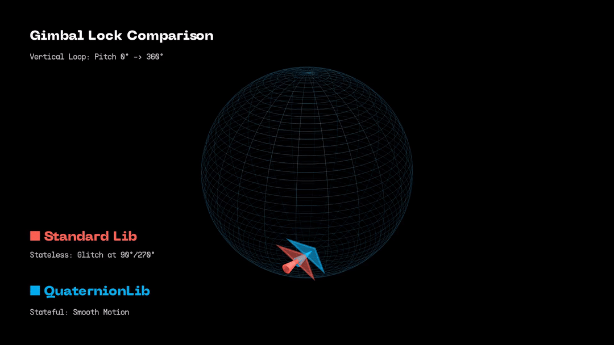

# QuaternionLib: Continuity-Aware Euler Conversion


> **Visual Comparison:** The Red plane (Standard Library) violently snaps when Pitch hits 90°, losing orientation. The Cyan plane (QuaternionLib) maintains smooth, continuous motion using stateful history extrapolation.

## 1. The Theory & The Problem

### The Topology Mismatch (The "Hairy Ball" Theorem)
Rotations exist on a hypersphere ($S^3$), while Euler angles exist on a flat coordinate system ($\mathbb{R}^3$). Topologically, it is impossible to map the smooth surface of a sphere onto a flat grid without at least one point where the map "tears" or becomes singular.

In Euler angles, this tear is known as **Gimbal Lock**. When the middle rotation aligns the two outer axes (e.g., Pitch = $\pm 90^\circ$ in a Tait-Bryan sequence), one degree of freedom is lost. Mathematically, this means there are **infinite valid solutions** for the remaining angles.
* *Example:* At the North Pole, `[Yaw: 10, Pitch: 90, Roll: 0]` describes the exact same physical orientation as `[Yaw: 20, Pitch: 90, Roll: -10]`.

### The "Glitch" in Time-Series Data
Standard math libraries (like Eigen or GLM) are **stateless**. When they encounter this singularity, they must make an arbitrary choice (e.g., "Always force Roll to 0").

In a dynamic system—like a robotic arm moving through a singularity or a camera panning straight down—this arbitrary choice creates a massive **Temporal Discontinuity**.

**The Artifact:**
* Frame $t-1$: `[Yaw: 45°, Pitch: 89°, Roll: 45°]`
* Frame $t$ (Singularity): `[Yaw: 90°, Pitch: 90°, Roll: 0°]` *(Library forces Roll to 0)*
* Frame $t+1$: `[Yaw: 46°, Pitch: 89°, Roll: 46°]`

To a PID controller or a physics engine, this looks like the object violently snapped its wrist ($0 \rightarrow 45$) in a single microsecond. This results in **Control Spikes** in motors and **Visual Jitter** in animation.

## 2. The Solution

**QuaternionLib** treats Euler conversion as a **Time-Series Problem**, not just a geometric one.

Instead of calculating the conversion in isolation, it maintains a history buffer of recent states. When the system approaches a singularity, it uses this history to enforce continuity:

1.  **Extrapolation:** The library uses **Lagrange Polynomials** and **Derivative Estimation** to predict where the angles *should* be based on the trajectory of the last $N$ frames.
2.  **Selection:** It solves the Gimbal Lock equation to find the infinite set of valid angles, then selects the specific solution that minimizes the error against the extrapolated prediction.

This acts as a **Continuity Filter**, allowing physical systems to pass smoothly through the North/South poles without numerical glitches.

## 3. Supported Rotation Sequences

There are a total of 12 Euler angle rotation sequences supported by this library. They are defined as an enum in `quaternion.h`:

```cpp
enum rotation_order
{
    // circular, repeated
    eXYX,
    eYZY,
    eZXZ,
    // non-circular, repeated
    eXZX,
    eYXY,
    eZYZ,
    // circular, non-repeated
    eXYZ,
    eYZX,
    eZXY,
    // non-circular, non-repeated
    eXZY,
    eYXZ,
    eZYX
};
```

These determine the order in which rotations are applied. The "repeated" orders are commonly referred to as Proper Euler Angles, while the "non-repeated" orders are referred to as Tait-Bryan angles.

## 4. Usage
### C++ integration
1. **CMake Setup**: Since `QuaternionLib` is a modern CMake interface library, you can include it via `add_subdirectory` or `FetchContent`:
```cmake
add_subdirectory(path/to/QuaternionLib)
target_link_libraries(MyGame PRIVATE QuaternionLib::QuaternionLib)
```
2. **Basic Usage (Stateful)**: Use the `StatefulConverter` class to automatically manage history buffers and time-step calculations.

```c++
#include <QuaternionLib/stateful_converter.h>

// 1. Initialize converter (e.g. as a member variable of your Player class)
//    Params: Rotation Order, History Buffer Size (default 5)
QuatLib::StatefulConverter<double> converter(QuatLib::RotationOrder::ZYX);

void Update(double dt) {
    // Get current orientation from physics engine (Eigen::Quaterniond)
    Eigen::Quaterniond current_quat = GetPhysicsRotation();

    // 2. Convert! 
    //    Pass 'dt' (delta time) to ensure velocity calculations handle frame-rate jitter.
    auto euler = converter.update(current_quat, dt);

    // Access results (ZYX order: [0]=Yaw, [1]=Pitch, [2]=Roll)
    double yaw   = euler.angles[0]; 
    double pitch = euler.angles[1];
    double roll  = euler.angles[2];
}
```
### Python Integration
1. **Building the Binding**: Ensure you have CMake installed, then build the project:
```bash
mkdir build && cd build
cmake ..
make
# This generates quaternionlib.so (or .pyd on Windows) in the build folder
```

2. **Script Usage**
```python
import sys
sys.path.append("path/to/build/folder") # Ensure python can find the .so
import quaternionlib as ql
import numpy as np

# 1. Initialize
converter = ql.Converter(ql.RotationOrder.ZYX)

# 2. Update Loop
#    Input quaternion must be a numpy array [x, y, z, w]
q_coeffs = np.array([0.0, 0.707, 0.0, 0.707]) 
dt_seconds = 0.016

#    Returns an object with an .angles property (Eigen vector -> Numpy array)
result = converter.update(q_coeffs, dt=dt_seconds)

print(f"Yaw: {result.angles[0]}, Pitch: {result.angles[1]}, Roll: {result.angles[2]}")
```

## 5. Implementation Details

I conducted a thorough review of algorithms for converting between quaternions, Euler angles, and rotation matrices. I concluded that the method proposed by Hughes is the most elegant for general geometric conversion. However, the original method does not account for the singularity (Gimbal Lock) continuity problem, and the paper contained several mathematical errors which have been corrected here.

### Handling Singularities
After implementing the base Hughes method, I addressed the continuity problem by introducing a Stateful Converter that maintains a history buffer of previous Euler angles and time-deltas ($dt$).

When a singularity is detected (or when aliasing checks are performed), the library employs the following logic:

1. **Unwrapping**: All angular differences are "unwrapped" (modulo $2\pi$) to ensure the shortest rotational path is used for velocity calculations. This handles cases where an angle jumps from $359^\circ$ to $1^\circ$.

2. **Velocity-Based Extrapolation**:

   - **Variable Time Step**: If $dt$ is provided, the solver calculates the true angular velocity ($\omega = \Delta\theta / \Delta t$) from the previous frame and projects it forward by the current frame's $dt$. This ensures smoothness even if the application's frame rate jitters (e.g., $16ms \to 33ms$).

   - **Constant Time Step**: If $dt$ is omitted, the solver assumes a uniform frame rate and extrapolates based on the raw per-frame delta.

3. **Solution Selection**: The extrapolated prediction is compared against the mathematically valid geometric solutions (which are often infinite or dual in nature). The solution minimizing the Euclidean distance to the prediction is selected.

## 6. Resources

### Code

- [Ken Shoemake's algorithm](https://github.com/erich666/GraphicsGems/tree/master/gemsiv/euler_angle)
- [coderlirui's algorithm](https://github.com/coderlirui/quat2eul)
- [J. Fuller's algorithm](https://github.com/drew-gross/MATLAB/blob/master/AutonomousHw1/ME597-3-SpinCalc/SpinCalc.m)

### Papers and articles

- [Slabaugh](https://www.researchgate.net/profile/Thomas-Blesgen/publication/276852668_On_rotation_deformation_zones_for_finite-strain_Cosserat_plasticity/links/55fbe44808ae07629e07c60c/On-rotation-deformation-zones-for-finite-strain-Cosserat-plasticity.pdf)
- [Kuipers](https://www.emis.de/proceedings/Varna/vol1/GEOM09.pdf)
- [Ben-Ari](https://www.weizmann.ac.il/sci-tea/benari/sites/sci-tea.benari/files/uploads/softwareAndLearningMaterials/quaternion-tutorial-2-0-1.pdf)
- [Hughes](https://www.researchgate.net/publication/318276971_Quaternion_tofrom_Euler_Angle_of_Arbitrary_Rotation_Sequence_Direction_Cosine_Matrix_Conversion_Using_Geometric_Methods)
- [Perumal](https://core.ac.uk/download/pdf/228833209.pdf)
- [euclideanspace](http://www.euclideanspace.com/maths/geometry/rotations/conversions/quaternionToEuler/index.htm)

### Visulaziation and Converter Tools

- [quaterions.online](https://quaternions.online/)
- [Andre Gaschler](https://www.andre-gaschler.com/rotationconverter/)